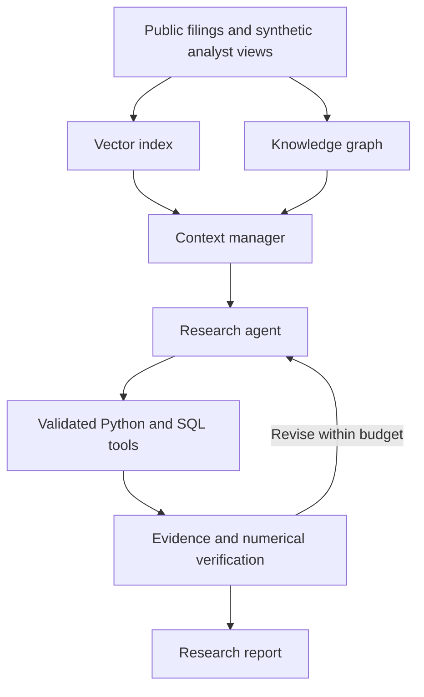

# Agentic investment research — capstone design

Use only public or synthetic data in this repository. Keep proprietary analyst and portfolio data out of Git history and GitHub Pages.

Use point-in-time documents to avoid look-ahead bias. Store source, timestamp, thesis, catalyst, risk and horizon. Compare vector RAG, graph retrieval and hybrid retrieval. Evaluate source coverage, numerical accuracy, calibrated forecasts (Brier score), and cost. Start with deterministic tools and human review; no autonomous trading. LoRA and production inference are optional later steps.
