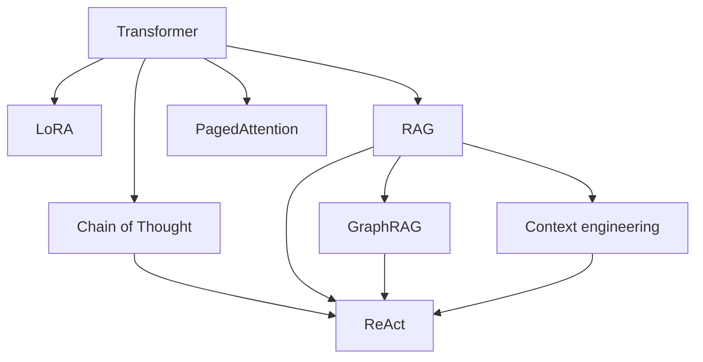

# How the papers fit together

The Transformer provides the architecture; LoRA adapts model parameters; RAG supplies external evidence; GraphRAG organizes relationships; Chain-of-Thought prompts intermediate reasoning; ReAct adds actions and observations; Lost in the Middle studies context limitations; PagedAttention improves serving efficiency.

These are conceptual relationships, not a verified citation graph or mandatory execution order.

## Five kinds of memory

| Type | Representation | Papers |
|---|---|---|
| Parametric | Model weights | Transformer, LoRA |
| External semantic | Document and vector stores | RAG |
| Relational | Entities and edges | GraphRAG |
| Working | Context and agent history | Lost in the Middle, ReAct, CoT |
| Computational | KV cache | PagedAttention |

Information availability is not the same as information utilization. A bigger context window and more efficient caching do not guarantee better answers.

## Engineering disciplines

Prompt engineering specifies instructions; context engineering selects and orders information; harness engineering manages tools, state and validation; loop engineering designs repeated action and feedback; inference engineering optimizes resource use. These labels overlap.

## Key comparisons

LoRA changes effective weights; RAG changes input evidence. Vector RAG retrieves passages; GraphRAG supports relationship and corpus-level synthesis. CoT produces intermediate reasoning; ReAct interacts with the environment. PagedAttention optimizes storage, not reasoning quality.
